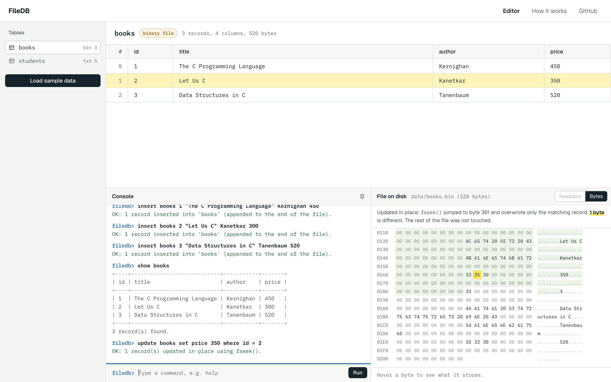
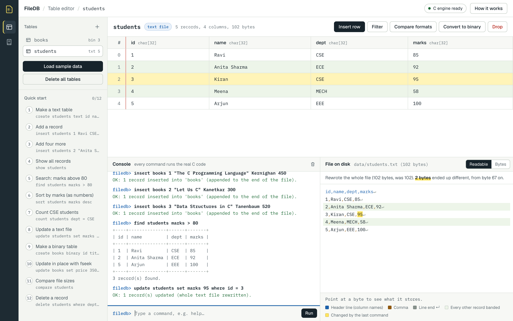

# FileDB: a simple file-based data engine in C

**Store, query and update records in plain text or binary files.**

FileDB is a small database engine written in C. You create tables, add records, search them, change them and delete them. Every table is saved as **one file**, and you choose whether that file is **plain text** (readable in Notepad) or **binary** (fixed-size records).

The same C code runs in two places:

- **In your terminal**, as a normal C program (`./filedb`).
- **In a web browser**, compiled to WebAssembly. The website shows each table as a grid and shows the file's raw bytes, so you can see exactly what every command changes.

Live website: **https://filedb-kappa.vercel.app**  (demo: [binary file](https://filedb-kappa.vercel.app/?demo=binary), [text file](https://filedb-kappa.vercel.app/?demo=text), [docs](https://filedb-kappa.vercel.app/?view=docs))





---

## Contents

1. [Quick start](#quick-start)
2. [All commands](#all-commands)
3. [Example session](#example-session)
4. [How tables are stored](#how-tables-are-stored)
5. [Project structure](#project-structure)
6. [The website](#the-website)
7. [Tests](#tests)
8. [Limits](#limits)
9. [More documentation](#more-documentation)

---

## Quick start

You need a C compiler (`gcc` or `clang`) and `make`.

```bash
make            # build the program
./filedb        # start it
```

Then type commands at the `filedb>` prompt:

```text
filedb> create students text id name dept marks
filedb> insert students 1 Ravi CSE 85
filedb> show students
filedb> exit
```

Without `make`, you can compile directly:

```bash
gcc -Wall -std=c99 -o filedb src/main.c src/storage.c src/commands.c
```

---

## All commands

| Command | What it does |
|---|---|
| `create <table> <text\|binary> <col1> <col2> ...` | Make a new table and choose how it is stored |
| `insert <table> <value1> <value2> ...` | Add one record (one value per column) |
| `show <table>` | Show every record |
| `find <table> <col> <op> <value>` | Show the records that match a condition |
| `sort <table> <col> [asc\|desc]` | Show the records in order (the file is not changed) |
| `count <table> [<col> <op> <value>]` | Count all records, or only matching ones |
| `update <table> set <col> <value> where <col> <op> <value>` | Change a value in matching records |
| `delete <table> where <col> <op> <value>` | Remove matching records |
| `tables` | List all tables |
| `describe <table>` | Show columns, format, file size and byte layout |
| `compare <table>` | Compare the file size as text vs as binary |
| `convert <table> <text\|binary>` | Change how a table is stored |
| `drop <table>` | Delete a table and its file |
| `help` / `exit` | List commands / quit |

**Operators:** `=`  `!=`  `>`  `<`  `>=`  `<=`  `contains`

**Values with spaces** go in double quotes: `insert students 2 "Anita Sharma" ECE 92`

Numbers are compared as numbers, so `9 < 78` (as plain text, "9" would come after "78").

---

## Example session

This is real output from the program:

```text
filedb> create students text id name dept marks
OK: table 'students' created with 4 column(s), stored as text.
filedb> insert students 1 Ravi CSE 85
OK: 1 record inserted into 'students' (appended to the end of the file).
filedb> insert students 2 "Anita Sharma" ECE 92
OK: 1 record inserted into 'students' (appended to the end of the file).
filedb> insert students 3 Kiran CSE 78
OK: 1 record inserted into 'students' (appended to the end of the file).
filedb> find students marks > 80
+----+--------------+------+-------+
| id | name         | dept | marks |
+----+--------------+------+-------+
| 1  | Ravi         | CSE  | 85    |
| 2  | Anita Sharma | ECE  | 92    |
+----+--------------+------+-------+
2 record(s) found.
filedb> update students set marks 95 where id = 3
OK: 1 record(s) updated (whole text file rewritten).
filedb> create books binary id title price
OK: table 'books' created with 3 column(s), stored as binary.
filedb> insert books 1 "Let Us C" 300
OK: 1 record inserted into 'books' (appended to the end of the file).
filedb> update books set price 350 where id = 1
OK: 1 record(s) updated in place using fseek().
filedb> describe books
Table   : books
File    : data/books.bin
Format  : binary
Records : 1
Size    : 200 bytes
Columns : id title price
Layout  : header 104 bytes + 96 bytes per record
filedb> compare students
Same 3 record(s) stored two ways:
  text   :     70 bytes  (only the characters needed; easy to read)
  binary :    520 bytes  (every record is 128 bytes; fast to jump to)
```

---

## How tables are stored

Tables are saved in the `data/` folder, one file per table.

### Text format: `data/<table>.txt`

```text
id,name,dept,marks        <- line 1: the column names
1,Ravi,CSE,85             <- every other line: one record
2,Anita Sharma,ECE,92
3,Kiran,CSE,95
```

- Values are separated by commas, and each record ends with a newline.
- You can open the file in any editor, or in Excel.
- Lines have different lengths, so to change one value the program **rewrites the whole file**.

### Binary format: `data/<table>.bin`

```text
+--------+-----------+-----------------------+----------+----------+-----
| "FDB1" | num_cols  | column names          | record 0 | record 1 | ...
| 4 bytes| 4 bytes   | num_cols x 32 bytes   |          |          |
+--------+-----------+-----------------------+----------+----------+-----
                                               each record = num_cols x 32 bytes
```

- `FDB1` is a "magic number": 4 bytes that mark the file as a FileDB file.
- Every value gets a fixed **32-byte slot**. Unused bytes are filled with `0`.
- Because every record has the same size, the program can calculate where record *N* starts:

  ```text
  position = header size + N x record size
  ```

  It jumps there with `fseek()` and **overwrites only that record**. No other byte is touched.

### Which one is better?

| | Text | Binary |
|---|---|---|
| Can a person read it? | Yes | No |
| File size | Small (only the characters typed) | Bigger (fixed 32-byte slots) |
| Changing one record | Rewrite the whole file | Jump with `fseek()`, overwrite in place |
| Finding record number N | Read all lines before it | Calculate its position directly |

The `compare` command shows the difference on your own data.

### How each command uses the file

| Command | What happens to the file |
|---|---|
| `insert` | Opened in **append** mode (`"a"` / `"ab"`). The new record is added at the end. |
| `update` (binary) | Opened in `"r+b"` mode. `fseek()` jumps to the record and only it is overwritten. |
| `update` (text), `delete` | The whole table is written again (`"w"` / `"wb"`). |
| `show`, `find`, `sort`, `count` | Read only. `sort` sorts a copy in memory, so the file is not changed. |

---

## Project structure

```text
FileDB/
├── src/
│   ├── filedb.h       shared definitions: Record and Table structs, limits, function list
│   ├── storage.c      everything that touches files: load, save, append, overwrite in place
│   ├── commands.c     understands what you typed and runs the command
│   └── main.c         terminal loop: prompt -> read line -> run -> repeat
├── tests/
│   └── run_tests.sh   35 automatic tests
├── web/               the website (C compiled to WebAssembly + HTML/CSS/JS)
├── docs/
│   └── VIVA_GUIDE.md  plain-language explanation of every part, with likely questions
├── Makefile           build commands
└── README.md          this file
```

How a command flows through the code:

```text
you type a line
      |
      v
main.c        reads the line with fgets()
      |
      v
commands.c    execute() -> tokenize() splits it into words
              -> picks the matching cmd_xxx() function
      |
      v
storage.c     load_table() reads the file into memory
              ... the command does its work in memory ...
              append_record() / overwrite_record() / save_table() writes it back
```

---

## The website

The `web/` folder is a static website. It runs the **same** `storage.c` and `commands.c`, compiled to WebAssembly with [Emscripten](https://emscripten.org):

```bash
make web        # creates web/filedb.js and web/filedb.wasm
```

- `main.c` is not used on the web. Instead, the page calls the C function `execute()` each time you press Enter.
- Files are kept in the browser's storage (IndexedDB), so your tables survive a page refresh.
- The page draws each table as a grid and shows the file's bytes. After every command, the bytes that changed are highlighted.

To run it locally (browsers do not load WebAssembly from `file://`):

```bash
python3 -m http.server 8000 --directory web
# then open http://localhost:8000
```

Demo links (load sample data and show a change): `?demo=text`, `?demo=binary`, for example https://filedb-kappa.vercel.app/?demo=binary

---

## Tests

```bash
make test
```

The test script sends commands to `./filedb` and checks the output. It covers every command, both file formats, data surviving a restart, the file layout (magic bytes, header line), and error handling (wrong value count, unknown table/column/operator, commas in values, values that are too long, `../` path tricks).

```text
Result: 35 passed, 0 failed.
```

---

## Limits

These limits keep the code simple. They are set in `src/filedb.h` and can be changed there.

| Limit | Value |
|---|---|
| Columns per table | 10 |
| Records per table | 1000 |
| Characters per value | 31 |
| Table and column names | Start with a letter, then letters, digits or `_` |
| Values | Not empty, no commas (the comma separates values in text files) |

---

## More documentation

- **[docs/VIVA_GUIDE.md](docs/VIVA_GUIDE.md)**: explains every file and function in simple words, with answers to likely questions.
- **docs/FileDB_Project_Report.docx**: the project report in the college template.
